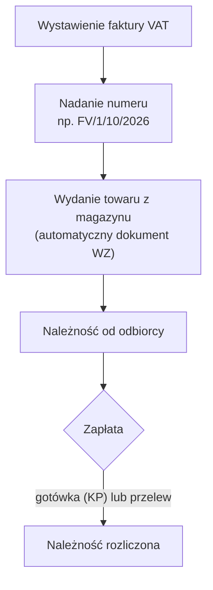
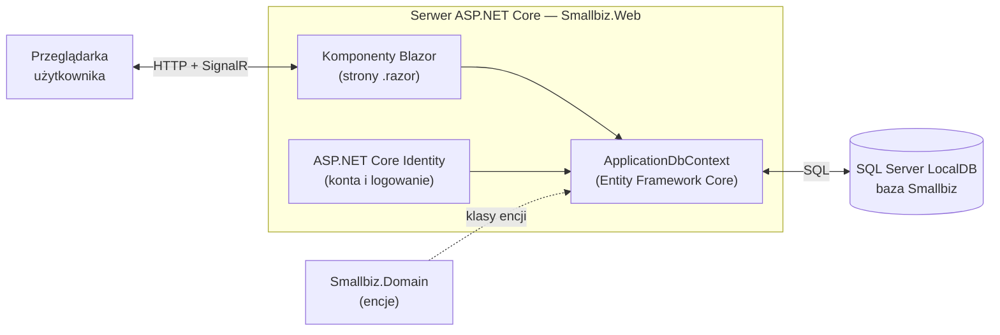
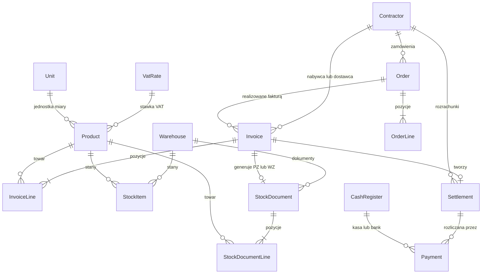

# SmallBiz — dokumentacja projektu

- **Projekt:** SmallBiz — zintegrowany system zarządzania małym przedsiębiorstwem
- **Autorzy:** Bogdan Emodi, Piotr Czarnocki, Karol Jurewicz
- **Przedmiot:** Dynamiczna Analiza Oprogramowania
- **Prowadzący:** Konrad Maleńczak
- **Repozytorium:** `github.com/bodzio28/smallbiz`
- **Wersja dokumentu:** 0.1 (12.10.2026)

## Spis treści

1. [Wprowadzenie](#1-wprowadzenie)
2. [Koncepcja systemu](#2-koncepcja-systemu)
3. [Wymagania](#3-wymagania)
4. [Architektura i technologie](#4-architektura-i-technologie)
5. [Model danych](#5-model-danych)
6. [Instalacja i uruchomienie](#6-instalacja-i-uruchomienie)
7. [Stan prac](#7-stan-prac)
8. [Plan rozwoju](#8-plan-rozwoju)
9. [Historia zmian dokumentu](#9-historia-zmian-dokumentu)

---

## 1. Wprowadzenie

### 1.1. Cel projektu

SmallBiz to aplikacja webowa wspierająca prowadzenie małego przedsiębiorstwa — jednoosobowej działalności gospodarczej lub firmy zatrudniającej kilka osób. Jej celem jest zebranie w jednym systemie podstawowych obszarów pracy firmy: ewidencji kontrahentów i towarów, sprzedaży, gospodarki magazynowej oraz rozliczeń finansowych. Zamiast prowadzić osobne arkusze, zeszyty i programy, firma wprowadza dane raz, a system wykorzystuje je we wszystkich modułach.

Aplikacja jest wzorowana na koncepcji programu Small Business firmy Simplex. Projekt realizowany jest w ramach zajęć i rozwijany etapami — niniejszy dokument opisuje docelowy zamysł systemu oraz stan prac po pierwszym etapie.

### 1.2. Zakres

Docelowo system obejmuje: kartoteki kontrahentów i towarów, sprzedaż (faktury VAT), zakupy, magazyn, kasę i bank, rozrachunki, zamówienia, raporty oraz zarządzanie użytkownikami i ich uprawnieniami.

Poza zakresem projektu pozostają m.in.: pełna księgowość (księga przychodów i rozchodów, księgi handlowe), deklaracje i pliki podatkowe (JPK), integracja z Krajowym Systemem e-Faktur (KSeF), kadry i płace oraz obsługa wielu walut. Mogą one zostać rozważone jako rozszerzenia.

### 1.3. Słownik pojęć

| Pojęcie | Znaczenie |
|---|---|
| Kontrahent | Firma lub osoba, z którą przedsiębiorstwo prowadzi wymianę handlową: odbiorca (klient) lub dostawca. |
| NIP | Numer identyfikacji podatkowej — 10 cyfr, z których ostatnia jest cyfrą kontrolną. |
| Faktura VAT | Dokument sprzedaży zawierający m.in. dane sprzedawcy i nabywcy, pozycje, wartości netto, kwotę podatku VAT i wartość brutto. |
| Netto / brutto | Wartość bez podatku VAT / wartość z podatkiem VAT. |
| Stawka VAT | Wysokość podatku VAT w procentach (np. 23%, 8%, 5%, 0%) lub oznaczenie szczególne (np. „zw” — sprzedaż zwolniona). |
| PZ | Przyjęcie zewnętrzne — dokument przyjęcia towaru od dostawcy do magazynu. |
| WZ | Wydanie zewnętrzne — dokument wydania towaru z magazynu odbiorcy. |
| KP / KW | Kasa przyjmie / kasa wyda — dokumenty wpłaty i wypłaty gotówki. |
| Rozrachunek | Rozliczenie z kontrahentem: należność (kwota do otrzymania od odbiorcy) lub zobowiązanie (kwota do zapłaty dostawcy). |
| Encja | Klasa C# odwzorowująca tabelę w bazie danych. |
| Migracja | Plik opisujący zmiany struktury bazy danych, generowany przez Entity Framework Core na podstawie klas encji. |

---

## 2. Koncepcja systemu

### 2.1. Ogólny zamysł

SmallBiz jest systemem **zintegrowanym**: moduły korzystają ze wspólnych danych, a jedna operacja aktualizuje wszystkie powiązane obszary. Przykładowo, wystawienie faktury sprzedaży jednocześnie zmniejsza stan magazynu i tworzy należność od klienta — użytkownik nie wprowadza tych informacji osobno w każdym module.

Z systemu korzysta się przez przeglądarkę internetową. Każdy użytkownik loguje się na własne konto, a jego rola określa, do których modułów ma dostęp.

### 2.2. Użytkownicy i role

Obecnie zaimplementowane są rejestracja i logowanie użytkowników. Podział na role jest planowany:

| Rola | Zakres dostępu (planowany) |
|---|---|
| Administrator | Pełny dostęp; zarządzanie użytkownikami, danymi firmy i słownikami (stawki VAT, jednostki miary, numeracja dokumentów). |
| Sprzedawca | Kontrahenci, podgląd towarów i stanów, sprzedaż, zamówienia od klientów. |
| Magazynier | Towary, stany magazynowe, dokumenty magazynowe, przyjęcia dostaw. |
| Księgowość | Podgląd sprzedaży i zakupów, kasa i bank, rozrachunki, raporty. |

### 2.3. Moduły systemu

| Moduł | Funkcje | Status |
|---|---|---|
| Użytkownicy i logowanie | Rejestracja, logowanie i wylogowanie, zarządzanie kontem, zmiana hasła; role i uprawnienia | Logowanie zrealizowane, role planowane |
| Kontrahenci | Ewidencja odbiorców i dostawców, wyszukiwanie, walidacja NIP, oznaczanie kontrahentów nieaktywnych | W trakcie — model danych i tabela gotowe, brak ekranów |
| Towary i usługi | Kartoteka z symbolem, nazwą, jednostką miary, stawką VAT, cenami zakupu i sprzedaży | Planowany |
| Sprzedaż | Faktury VAT, automatyczna numeracja, wydruk z kwotą słownie | Planowany |
| Zakupy | Faktury zakupu od dostawców | Planowany |
| Magazyn | Stany towarów, dokumenty PZ i WZ, stan minimalny | Planowany |
| Kasa i bank | Dokumenty KP i KW, wpłaty i wypłaty z rachunku bankowego, salda | Planowany |
| Rozrachunki | Należności i zobowiązania, płatności po terminie | Planowany |
| Zamówienia | Zamówienia od klientów i do dostawców, wystawienie faktury na podstawie zamówienia | Planowany |
| Raporty i pulpit | Sprzedaż w okresie, stan magazynu, należności; pulpit z podsumowaniem | Planowany |

### 2.4. Integracja modułów — przykładowe procesy

**Sprzedaż.** Wystawienie faktury uruchamia ciąg operacji w kolejnych modułach:



**Zakup.** Wprowadzenie faktury zakupu powoduje przyjęcie towaru do magazynu (dokument PZ), aktualizację stanu i ceny zakupu towaru oraz powstanie zobowiązania wobec dostawcy. Zapłata (KW lub przelew) rozlicza zobowiązanie.

### 2.5. Założenia dla modułu sprzedaży

- Kwoty przechowywane są w typie `decimal`, który — w odróżnieniu od `double` — nie wprowadza błędów reprezentacji dwójkowej.
- Kwoty zaokrąglane są do grosza metodą „od połowy w górę”. Domyślne `Math.Round` w .NET stosuje zaokrąglanie do liczby parzystej, dlatego trzeba jawnie wskazać `MidpointRounding.AwayFromZero`.
- Kwota VAT liczona jest od sumy wartości netto pozycji w danej stawce; wartość brutto = netto + VAT.
- Dane nabywcy są kopiowane do faktury w chwili jej wystawienia, aby późniejsza zmiana danych kontrahenta nie zmieniała wystawionych dokumentów.
- Numer dokumentu jest unikalny w obrębie rodzaju dokumentu i nadawany według wzorca (np. `FV/{numer}/{miesiąc}/{rok}`).

---

## 3. Wymagania

### 3.1. Wymagania funkcjonalne

| ID | Wymaganie | Status |
|---|---|---|
| WF01 | Rejestracja konta użytkownika (e-mail i hasło) z potwierdzeniem konta | Zrealizowane |
| WF02 | Logowanie i wylogowanie; zarządzanie kontem (zmiana hasła, adresu e-mail) | Zrealizowane |
| WF03 | Role użytkowników i ograniczenie dostępu do modułów | Planowane |
| WF04 | Dodawanie, edycja i przeglądanie kontrahentów; wyszukiwanie po nazwie, kodzie i NIP | W trakcie (model danych) |
| WF05 | Oznaczanie kontrahenta jako odbiorcy i/lub dostawcy oraz jako nieaktywnego | W trakcie (model danych) |
| WF06 | Walidacja numeru NIP (cyfra kontrolna) | Planowane |
| WF07 | Kartoteka towarów i usług (symbol, nazwa, jednostka, stawka VAT, ceny) | Planowane |
| WF08 | Wystawianie faktur VAT z automatycznym wyliczeniem wartości netto, VAT i brutto | Planowane |
| WF09 | Automatyczna numeracja dokumentów według wzorca | Planowane |
| WF10 | Wydruk faktury z kwotą słownie | Planowane |
| WF11 | Ewidencja stanów magazynowych; dokumenty PZ i WZ | Planowane |
| WF12 | Automatyczne wydanie towaru z magazynu przy sprzedaży | Planowane |
| WF13 | Dokumenty kasowe KP/KW i ewidencja operacji na rachunku bankowym | Planowane |
| WF14 | Rozrachunki: lista należności i zobowiązań, wykaz płatności po terminie | Planowane |
| WF15 | Zamówienia od klientów i do dostawców; faktura na podstawie zamówienia | Planowane |
| WF16 | Raporty (sprzedaż w okresie, stan magazynu, należności) i pulpit z podsumowaniem | Planowane |

### 3.2. Wymagania niefunkcjonalne

| ID | Wymaganie | Status |
|---|---|---|
| NF01 | Aplikacja webowa obsługiwana przez przeglądarkę, bez instalacji po stronie użytkownika | Zrealizowane |
| NF02 | Implementacja w technologii .NET (C#) | Zrealizowane |
| NF03 | Przechowywanie danych w relacyjnej bazie Microsoft SQL Server | Zrealizowane |
| NF04 | Hasła przechowywane wyłącznie w postaci skrótu (hash) | Zrealizowane (ASP.NET Core Identity) |
| NF05 | Struktura bazy danych wersjonowana migracjami, kod w repozytorium Git | Zrealizowane |
| NF06 | Dostęp do funkcji systemu wyłącznie po zalogowaniu | Planowane — obecnie logowania wymaga tylko strona testowa `/auth` |
| NF07 | Interfejs w języku polskim | Planowane — obecnie angielskie teksty szablonu |
| NF08 | Interfejs dostosowany do różnych rozmiarów ekranu | Częściowo — układ szablonu oparty na Bootstrap 5 |
| NF09 | Dokładność obliczeń kwotowych (typ `decimal`, zaokrąglenie do grosza) | Planowane (moduł sprzedaży) |

---

## 4. Architektura i technologie

### 4.1. Technologie

| Obszar | Technologia | Wersja |
|---|---|---|
| Platforma i język | .NET, C# | .NET 10 |
| Aplikacja webowa | ASP.NET Core Blazor Web App, tryb Interactive Server | .NET 10 |
| Dostęp do danych | Entity Framework Core (podejście Code First) | 10.0.12 |
| Baza danych | Microsoft SQL Server Express LocalDB | 17.0 (SQL Server 2025) |
| Uwierzytelnianie | ASP.NET Core Identity | 10.0.12 |
| Wygląd interfejsu | Bootstrap | 5.3.3 |
| Kontrola wersji | Git, GitHub | — |
| Narzędzia | Visual Studio Community 2026, SQL Server Management Studio 22, `dotnet-ef` | `dotnet-ef` 10.0.12 |

### 4.2. Architektura aplikacji

Aplikacja działa w modelu **Blazor Server**:

- Kod aplikacji — interfejs i logika — wykonuje się na serwerze ASP.NET Core.
- Po załadowaniu strony przeglądarka utrzymuje stałe połączenie z serwerem (SignalR, zazwyczaj przez WebSocket). Zdarzenia użytkownika (kliknięcia, wpisywane dane) trafiają na serwer, gdzie wykonuje się kod C# komponentu, a zmiany interfejsu są odsyłane do przeglądarki i nanoszone tylko na zmieniony fragment strony.
- Komponenty korzystają z bazy danych przez Entity Framework Core, który tłumaczy zapytania LINQ na język SQL.
- Strony konta (logowanie, rejestracja) działają w trybie statycznego renderowania po stronie serwera, ponieważ mechanizm logowania opiera się na ciasteczku ustawianym w zwykłej odpowiedzi HTTP.



### 4.3. Struktura rozwiązania

```
smallbiz/
├── Smallbiz.slnx                    plik rozwiązania
├── README.md
├── docs/
│   └── dokumentacja.md              niniejszy dokument
└── src/
    ├── Smallbiz.Domain/             model biznesowy
    │   └── Entities/
    │       └── Contractor.cs        encja kontrahenta
    └── Smallbiz.Web/                aplikacja Blazor
        ├── Components/
        │   ├── Account/             strony konta (ASP.NET Core Identity)
        │   ├── Layout/              układ strony i menu
        │   └── Pages/               strony aplikacji
        ├── Data/
        │   ├── ApplicationDbContext.cs
        │   ├── ApplicationUser.cs
        │   └── Migrations/          migracje Entity Framework Core
        ├── wwwroot/                 pliki statyczne (CSS, Bootstrap)
        ├── Program.cs               konfiguracja usług i uruchomienie aplikacji
        └── appsettings.json         konfiguracja, m.in. parametry połączenia z bazą
```

Rozwiązanie składa się z dwóch projektów:

- **Smallbiz.Domain** zawiera encje opisujące dziedzinę biznesową. Nie zależy od Entity Framework ani ASP.NET Core — korzysta wyłącznie z atrybutów `System.ComponentModel.DataAnnotations` wbudowanych w .NET. Dzięki temu model biznesowy jest niezależny od technologii przechowywania danych.
- **Smallbiz.Web** zawiera interfejs użytkownika, konfigurację, dostęp do danych i mechanizm logowania. Odwołuje się do projektu Smallbiz.Domain.

Wraz z rozbudową systemu planowane jest wydzielenie warstwy logiki biznesowej (serwisów) oraz dodanie projektu z testami.

### 4.4. Dostęp do danych

- Projekt wykorzystuje podejście **Code First**: struktura bazy wynika z klas C#, a zmiany wprowadzane są migracjami generowanymi przez narzędzie `dotnet ef`.
- `ApplicationDbContext` dziedziczy po `IdentityDbContext<ApplicationUser>`, dzięki czemu obejmuje zarówno tabele ASP.NET Core Identity, jak i tabele aplikacji (`DbSet<Contractor> Contractors`).
- Parametry połączenia zapisane są w `appsettings.json` pod kluczem `ConnectionStrings:DefaultConnection`. Aplikacja łączy się z bazą `Smallbiz` na serwerze `(localdb)\MSSQLLocalDB` z uwierzytelnianiem Windows.
- Atrybuty `[Required]` i `[MaxLength]` w klasach encji określają, czy kolumna dopuszcza wartość NULL, oraz jej długość. W kolejnych etapach posłużą także do walidacji formularzy.
- Informacja o zastosowanych migracjach zapisywana jest w tabeli `__EFMigrationsHistory`.

| Migracja | Zakres |
|---|---|
| `00000000000000_CreateIdentitySchema` | Tabele ASP.NET Core Identity (z szablonu projektu) |
| `20261011180539_AddContractors` | Tabela `Contractors` |

### 4.5. Uwierzytelnianie i bezpieczeństwo

- Konta użytkowników obsługuje **ASP.NET Core Identity**: rejestracja, logowanie (ciasteczko uwierzytelniające), wylogowanie, zarządzanie kontem i zmiana hasła. Szablon zawiera także obsługę uwierzytelniania dwuskładnikowego i kluczy dostępu (passkeys).
- Hasła przechowywane są wyłącznie jako skrót (algorytm PBKDF2). Obowiązują domyślne wymagania Identity: co najmniej 6 znaków, wielka i mała litera, cyfra oraz znak specjalny.
- Konto wymaga potwierdzenia (`RequireConfirmedAccount = true`). Aplikacja nie wysyła jeszcze wiadomości e-mail — link potwierdzający wyświetla się na stronie po rejestracji. Takie rozwiązanie jest właściwe wyłącznie w środowisku deweloperskim.
- Formularze są chronione przed atakami CSRF (mechanizm antiforgery), a ruch HTTP jest przekierowywany na HTTPS.

---

## 5. Model danych

### 5.1. Stan obecny

Tabele ASP.NET Core Identity (utworzone migracją z szablonu):

| Tabela | Zawartość |
|---|---|
| `AspNetUsers` | Konta użytkowników: login, e-mail, skrót hasła, dane zabezpieczeń |
| `AspNetRoles` | Role |
| `AspNetUserRoles` | Przypisanie ról do użytkowników |
| `AspNetUserClaims`, `AspNetRoleClaims` | Dodatkowe uprawnienia (claims) użytkowników i ról |
| `AspNetUserLogins` | Logowanie przez zewnętrznych dostawców (np. konto Google) |
| `AspNetUserTokens` | Tokeny, m.in. do uwierzytelniania dwuskładnikowego |
| `AspNetUserPasskeys` | Klucze dostępu (passkeys) |
| `__EFMigrationsHistory` | Lista zastosowanych migracji |

Tabela `Contractors` (encja `Contractor`, migracja `AddContractors`):

| Kolumna | Typ SQL | Wymagana | Opis |
|---|---|---|---|
| `Id` | `int`, IDENTITY | tak | Klucz główny, nadawany automatycznie |
| `Code` | `nvarchar(40)` | tak | Kod (skrót) kontrahenta |
| `TaxId` | `nvarchar(20)` | nie | NIP |
| `Name` | `nvarchar(200)` | tak | Pełna nazwa |
| `Country` | `nvarchar(100)` | tak | Kraj; w aplikacji domyślnie „Polska” |
| `City` | `nvarchar(100)` | tak | Miejscowość |
| `Street` | `nvarchar(200)` | tak | Ulica i numer |
| `PostalCode` | `nvarchar(20)` | tak | Kod pocztowy |
| `Phone` | `nvarchar(30)` | nie | Telefon |
| `Email` | `nvarchar(150)` | nie | Adres e-mail |
| `IsCustomer` | `bit` | tak | Odbiorca (klient); w aplikacji domyślnie tak |
| `IsSupplier` | `bit` | tak | Dostawca |
| `IsActive` | `bit` | tak | Kontrahent aktywny; w aplikacji domyślnie tak |

Wartości domyślne ustawia kod C# w chwili tworzenia obiektu — kolumny w bazie nie mają wartości domyślnych, dlatego przy ręcznym wprowadzaniu danych (np. w SQL Server Management Studio) trzeba je podać.

### 5.2. Planowany model danych

Poniższy diagram przedstawia koncepcję docelowego modelu. Nazwy i szczegóły encji mogą zmienić się w trakcie implementacji.



| Encja | Opis |
|---|---|
| `Contractor` | Kontrahent (istnieje) |
| `Product` | Towar lub usługa: symbol, nazwa, jednostka, stawka VAT, ceny zakupu i sprzedaży, stan minimalny |
| `VatRate` | Stawka VAT (23%, 8%, 5%, 0%, zw) |
| `Unit` | Jednostka miary (szt., kg, godz.) |
| `Warehouse` | Magazyn |
| `StockItem` | Stan towaru w magazynie wraz ze średnią ceną zakupu |
| `StockDocument`, `StockDocumentLine` | Dokument magazynowy (PZ, WZ) i jego pozycje |
| `Invoice`, `InvoiceLine` | Faktura sprzedaży lub zakupu i jej pozycje |
| `Settlement` | Rozrachunek: należność lub zobowiązanie wynikające z faktury |
| `CashRegister` | Kasa gotówkowa lub rachunek bankowy |
| `Payment` | Wpłata lub wypłata (KP, KW, przelew) |
| `Order`, `OrderLine` | Zamówienie od klienta lub do dostawcy i jego pozycje |

---

## 6. Instalacja i uruchomienie

### 6.1. Wymagania

- System Windows 10 lub 11 (SQL Server LocalDB działa wyłącznie w systemie Windows).
- .NET 10 SDK.
- SQL Server Express LocalDB — instalowany w Visual Studio Installer (*Modify* → *Individual components* → „SQL Server Express … LocalDB”) albo osobnym instalatorem SQL Server Express.
- Narzędzie `dotnet-ef`: `dotnet tool install --global dotnet-ef`.
- Opcjonalnie: Visual Studio 2026 i SQL Server Management Studio.

### 6.2. Pierwsze uruchomienie

1. Sklonuj repozytorium:
   ```bash
   git clone https://github.com/bodzio28/smallbiz.git
   cd smallbiz
   ```
2. Sprawdź, czy LocalDB jest zainstalowany — polecenie `sqllocaldb info` powinno wyświetlić `MSSQLLocalDB`.
3. Utwórz bazę danych na podstawie migracji:
   ```bash
   dotnet ef database update --project src/Smallbiz.Web
   ```
   Polecenie tworzy bazę `Smallbiz` z pustymi tabelami. Dane nie są przechowywane w repozytorium — każda instalacja zaczyna od pustej bazy.
4. Uruchom aplikację:
   ```bash
   dotnet run --project src/Smallbiz.Web
   ```
   Podczas pracy nad kodem wygodniejsze jest `dotnet watch --project src/Smallbiz.Web`, które przeładowuje aplikację po każdej zmianie.
5. Otwórz w przeglądarce adres wyświetlony w konsoli (domyślnie `http://localhost:5268`).
6. Kliknij *Register*, załóż konto, potwierdź je linkiem wyświetlonym na stronie i zaloguj się (*Login*).

Parametry połączenia znajdują się w pliku `src/Smallbiz.Web/appsettings.json`:

```json
"ConnectionStrings": {
  "DefaultConnection": "Server=(localdb)\\mssqllocaldb;Database=Smallbiz;Trusted_Connection=True;MultipleActiveResultSets=true"
}
```

Aby korzystać z innego serwera SQL Server (np. pełnej instancji), należy zmienić wartość `Server=` (dla serwera lokalnego: `Server=localhost;` z dopisanym `TrustServerCertificate=True;`) i ponownie wykonać `dotnet ef database update`.

### 6.3. Podgląd bazy danych

W SQL Server Management Studio należy połączyć się z serwerem `(localdb)\MSSQLLocalDB` (*Authentication*: Windows Authentication, zaznaczone *Trust server certificate*), a następnie rozwinąć *Databases* → *Smallbiz* → *Tables*. Bazę można też przeglądać w Visual Studio: *View* → *SQL Server Object Explorer*.

### 6.4. Wprowadzanie zmian w modelu danych

1. Zmień lub dodaj klasę encji w `src/Smallbiz.Domain/Entities` (dla nowej encji dodaj także `DbSet` w `ApplicationDbContext`).
2. Zatrzymaj uruchomioną aplikację — w przeciwnym razie zablokowane pliki uniemożliwią kompilację.
3. Wygeneruj migrację: `dotnet ef migrations add NazwaZmiany --project src/Smallbiz.Web`.
4. Przejrzyj wygenerowany plik w `Data/Migrations`.
5. Zastosuj migrację: `dotnet ef database update --project src/Smallbiz.Web`.
6. Zatwierdź w Git zmianę klasy razem z plikami migracji.

### 6.5. Rozwiązywanie problemów

| Objaw | Przyczyna | Rozwiązanie |
|---|---|---|
| `Connection string 'DefaultConnection' not found` | Zmieniona nazwa klucza w `appsettings.json` | Klucz musi nazywać się `DefaultConnection`; nazwę bazy zmienia się w części `Database=` |
| Błąd sieci z kodem `error: 52` — „Nie można zlokalizować instalacji aplikacji Local Database Runtime” | Brak zainstalowanego LocalDB | Doinstaluj LocalDB w Visual Studio Installer (*Modify* → *Individual components*) i sprawdź `sqllocaldb info` |
| Polecenie `sqllocaldb` nie jest rozpoznawane | LocalDB nie jest zainstalowany lub terminal otwarto przed instalacją | Zainstaluj LocalDB i otwórz nowe okno terminala |
| `dotnet ef migrations add` kończy się błędem kompilacji | Uruchomiona aplikacja blokuje pliki `.dll` | Zatrzymaj aplikację (Ctrl+C) i powtórz polecenie |
| Bazy `Smallbiz` nie widać w SQL Server Management Studio | Połączenie z innym serwerem (np. `localhost`) | Połącz się z serwerem `(localdb)\MSSQLLocalDB` |

---

## 7. Stan prac

### 7.1. Zrealizowane — wersja 0.1

- Repozytorium Git i rozwiązanie z projektami `Smallbiz.Domain` i `Smallbiz.Web`.
- Aplikacja Blazor Web App (.NET 10, tryb Interactive Server) z kontami użytkowników ASP.NET Core Identity — działająca rejestracja i logowanie.
- Baza danych `Smallbiz` w SQL Server LocalDB z tabelami Identity.
- Encja `Contractor` i migracja `AddContractors` tworząca tabelę `Contractors`.

| Data | Commit | Zakres zmian |
|---|---|---|
| 11.10.2026 | `9ae3eba` | Szkielet aplikacji: Blazor, Identity, SQL Server |
| 11.10.2026 | `038642d` | Parametry połączenia z bazą `Smallbiz` |
| 11.10.2026 | `0da2eb2` | Encja `Contractor` i migracja `AddContractors` |

### 7.2. Znane ograniczenia i poprawki do wykonania

- Brak ekranów obsługi kontrahentów (lista, formularz) — kolejny krok prac.
- W aplikacji pozostały strony przykładowe szablonu (*Counter*, *Weather*, *Auth*) oraz angielskie teksty interfejsu.
- Strony aplikacji nie wymagają zalogowania (poza testową stroną `/auth`).
- Brak walidacji numeru NIP.
- Aplikacja nie wysyła wiadomości e-mail — konto potwierdza się linkiem wyświetlanym na stronie.

---

## 8. Plan rozwoju

| Etap | Zakres |
|---|---|
| 1. Szkielet *(zrealizowany)* | Rozwiązanie, Blazor, Identity, baza danych, pierwsza encja |
| 2. Kartoteki | Lista i formularz kontrahentów (dodawanie, edycja, wyszukiwanie, dezaktywacja), walidacja NIP, unikalny kod; kartoteka towarów i usług, jednostki miary, stawki VAT; polskie menu i usunięcie stron przykładowych; wymaganie logowania; fabryka kontekstów EF Core (`AddDbContextFactory`) dla komponentów Blazor |
| 3. Sprzedaż | Faktura VAT z pozycjami i podsumowaniem według stawek VAT, automatyczna numeracja, wydruk z kwotą słownie |
| 4. Magazyn i zakupy | Magazyny i stany towarów, dokumenty PZ i WZ, automatyczne WZ przy sprzedaży, faktury zakupu z przyjęciem PZ |
| 5. Finanse | Kasa i rachunek bankowy, dokumenty KP i KW, rozrachunki: należności, zobowiązania, płatności po terminie |
| 6. Zamówienia i raporty | Zamówienia od klientów i do dostawców, raporty, pulpit z podsumowaniem |
| 7. Role i jakość | Role i uprawnienia użytkowników, testy jednostkowe obliczeń, instrukcja użytkownika ze zrzutami ekranu, dokumentacja końcowa |

---

## 9. Historia zmian dokumentu

| Wersja | Data | Opis zmian |
|---|---|---|
| 0.1 | 12.10.2026 | Pierwsza wersja: koncepcja systemu, wymagania, architektura, model danych, instrukcja uruchomienia, stan prac po etapie 1 |
